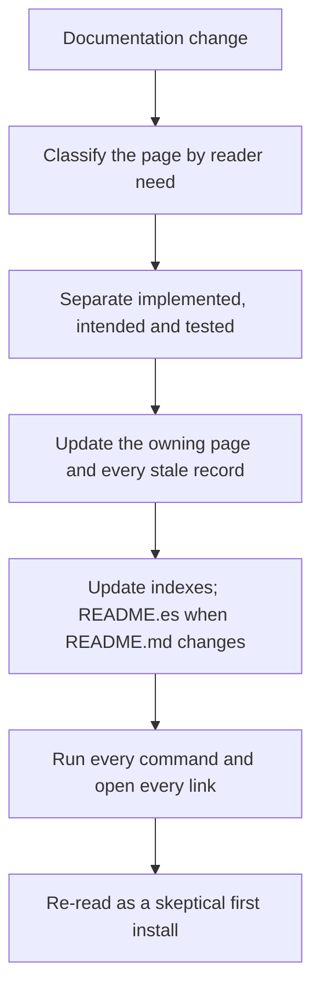

# Public documentation

Keep `README.md` the English landing page: branding, current status, a short
feature summary, quick-start commands and links. Detailed behavior lives in the
tracked `docs-public/` tree, which is organized by reader need
(tutorial, how-to, reference, explanation; see [Diátaxis](https://diataxis.fr/)).
Dated engineering evidence stays in `docs-private/`.

## Flow



## Where a page goes

| The page answers | Location |
| --- | --- |
| "How do I install or run it?" | `docs-public/getting-started/` |
| "What does this capability do?" | `docs-public/features/` (one page per feature group) |
| "What does this setting or mode do?" | `docs-public/configuration/` |
| "Why is the code built this way?" | `docs-public/architecture/` |
| "How do I build, test or review?" | `docs-public/development.md` |
| "Why did it fail or warn?" | `docs-public/troubleshooting.md` |
| "What is next or how is it versioned?" | `docs-public/roadmap.md`, `versioning.md` |
| Dated evidence of one change | `docs-private/records/` |

A feature page owns its behavior description. The README keeps only a summary and
a link, so a behavior change updates the feature page even when the summary stays
accurate.

## Procedure

1. Classify the change: landing summary, feature reference, configuration
   reference, architecture explanation, how-to or dated record.
2. State what is implemented, what is intended, and which versions were actually
   tested. Never merge the three into one claim.
3. Update every record the change makes stale in the same commit: the owning page,
   its section index, `docs-public/README.md` when a page is added, the landing
   summary, and `README.es.md` when `README.md` changes.
4. Run every command you write and open every link you add.
5. Re-read the claim as a skeptical stranger installing it for the first time.

## Rules

- Distinguish implemented behavior, intended scope, and validated environments.
- Use only working local links and real commands; no hypothetical release URLs,
  passing badges, screenshots, or build instructions presented as current.
- Keep `docs-private/` local and out of the published repository; `docs-public/`
  is tracked and published alongside `README.md`, `CHANGELOG.md`,
  `CONTRIBUTING.md`, `NOTICE.md` and the skills.
- Keep one record root: published living documents in `docs-public/`, private
  reference and dated records under `docs-private/`, and their evidence in
  `docs-private/records/assets/`.
- Preserve historical records; update living architecture docs when rules change.
- Every documentation directory has an index `README.md`, and every page is linked
  from that index. A new section starts with its index and an entry in
  `docs-public/README.md`.
- A published page never links into `docs-private/`.
- Repeatable local record workflows also have a template when that directory is
  introduced.

Check links, source language, attribution, and consistency with the roadmap.
Do not copy the original applet's installation or compatibility claims.

## Gotchas

- `docs-private/` is ignored by Git, so a public page must never link into it: the link
  works locally and breaks for every reader of the repository.
- `README.md` and `README.es.md` have no generator. A change to one is
  incomplete until the other matches.
- The release version appears in `CMakeLists.txt`,
  `modules/settings/PunchiSettingsAbout.qml`, both READMEs, `CHANGELOG.md`, `AGENTS.md`
  and `docs-public/versioning.md`. Updating only one declaration leaves the others
  stale.
- `tests/foundation_test.py` proves links resolve, section indexes cover every page
  and no public page links into `docs-private/`; it does not prove the text is true.
- A settings or format version written in prose must match the version the code
  declares, not the previous release.
- A new `docs-public/` or `docs-private/` subdirectory needs an index `README.md`,
  and a repeatable workflow also needs a template; missing either is a
  documentation defect.

## Validation

```bash
python3 tests/foundation_test.py
python3 scripts-dev/check-version.py
rg -n '0\.1\.[0-9]{2}' README.md README.es.md CMakeLists.txt \
   modules/settings/PunchiSettingsAbout.qml CHANGELOG.md AGENTS.md docs-public/versioning.md
```

Report which claims were re-verified and which remain unverified.
