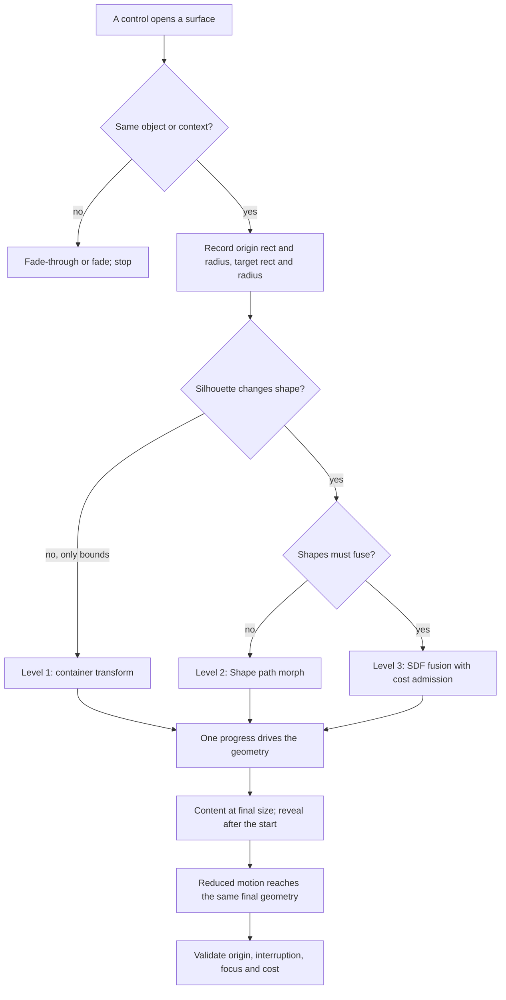

# Morph transitions

A morph is one surface becoming another while keeping the spatial relation between
the control and its result. Two unrelated surfaces fading into each other are a
fade-through, not a morph; do not present one as the other.

The caller names the surfaces. This skill decides the technique, the progress
model, the content timing and the fallback.

## Flow

## Coordination

- `animations` decides whether the transition earns its place.
- `fluid-motion` owns the concrete Qt Quick mechanism and reversal.
- `surface-effects` admits or rejects the shader at level 3.
- `animation-performance` measures the cost class.
- `accessibility` covers focus, names and reduced motion.
- `motion-review` audits an existing morph without changing code.

## Decide first

1. Relation: do origin and result represent the same object or the same context?
   If not, use a fade-through.
2. Geometry: origin rect and corner radius, target rect and corner radius, and the
   aspect-ratio change between them.
3. Content: does it already exist at its final geometry, or would the morph have
   to resize a layout?
4. Frequency: a surface opened tens of times a day gets the short version; a
   first-run or rare surface can carry the full one.
5. Interruption: can the surface close mid-flight? It must.
6. Reduced motion: which geometry and content remain, without travel.

## Levels

| Level | Technique | Mechanism | Cost |
|---|---|---|---|
| 1 | Container transform | One childless surface interpolates position, size and radius from the origin to the target; content is already at final size and reveals with a short fade. | LOW/MEDIUM |
| 2 | Path morph | One `Shape` path whose control points derive from the progress: capsule to panel, tail emerging, radius opening. | MEDIUM |
| 3 | SDF fusion | A `ShaderEffect` combines rounded-rect or capsule SDFs with a smooth minimum; anti-aliasing from screen derivatives; shadow from one `MultiEffect`. | HIGH |

Choose the lowest level that keeps the relation and the silhouette. A shader is
not the default answer to "make it morph".

## Implement

### One progress

- Drive every geometric property from a single `morphProgress`: 0 at the origin,
  1 at the target. Bind position, size, radius, tail and blend radius to it.
- Put a `Behavior` on the progress and let it retarget from the current value.
  Never pin `from` to the initial state and never call `stop()` before reversing.
- Opening and closing use the same geometry with opposite progress. Do not queue
  a second animation or wait for the first to finish.

### The surface, not the content

- The item that morphs has no layout children, so animating its geometry cannot
  relayout the content.
- Never animate the content's `width`, `height`, `implicitWidth`, `Layout.*`,
  margins or text size.
- Level 1 draws the surface at the animated geometry. Do not clip a full-size
  subtree to fake the reveal: clipping forces an offscreen pass.
- Level 2 keeps the path segment list stable and interpolates control points.
  `Shape` retessellates on the CPU whenever a path property changes, so keep one
  surface and a small path.
- Level 3 uses one shader instance, an opaque fill, and the admission criteria in
  `surface-effects`; a legible surface must remain when the effect is unavailable.

### Content

- Lay content out at its final geometry from the first frame.
- Reveal it during the last two thirds, after the surface has started moving.
  A fade plus a small offset is enough; do not scale text.
- Do not expose hit areas that are not visible yet. Keep focus on the origin until
  the surface is interactive, then move it once.
- On close, hide content early and return the surface; restore focus to the origin.

### Curves and durations

- Use `PunchiMotion.move` for the geometry: a morph is on-screen movement between
  equivalent states.
- Use `enter` and `exit` for the content reveal, like any opening and closing
  surface. Do not write a bezier array inline.
- Prefer theme durations (`longDuration` for the full morph, a shorter scaled
  duration for closing). A custom value needs a documented reason.
- No spring or bounce on a navigation morph; it breaks reversal and has no
  functional justification.

## Reduced motion

- Set the final geometry and content immediately; no arc, stagger or travel.
- Keep the same focus destination and the same readable final state.
- Never make motion the only indication that the surface changed.

## Validation

1. `qmllint` on the changed files.
2. Open and close at slow and fast input speed.
3. Reverse at roughly 30%, 50% and 70% of the progress.
4. Focus, accessible name and keyboard reachability after open and close.
5. Reduced motion: same final geometry, no travel.
6. Every panel orientation and scale the surface supports.
7. For level 2 or 3, measure frame time with several instances; report it as
   unmeasured until observed in a real session.

## Gotchas

- Scaling from the center is not a morph: it squashes content and discards the origin.
- Morphing unrelated surfaces lies about hierarchy; use a fade-through.
- Clipping a full-size content subtree is not the cheap option; it adds an
  offscreen pass.
- A path rebuilt every frame, or one with many segments, stops being MEDIUM.
- A shader introduced before the admission answers is an unnecessary effect.
- A morph that blocks input until it ends makes the control feel slow.
