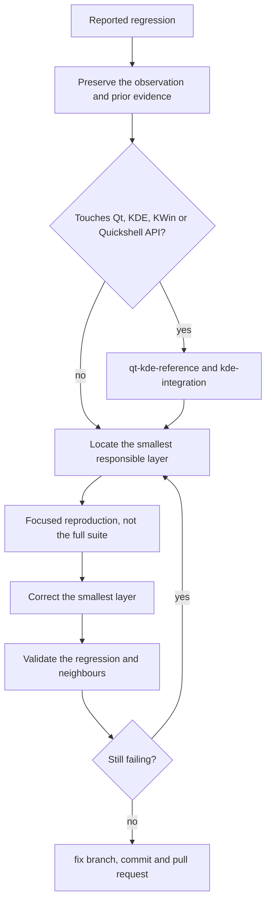

# Bug review

Preserve the user's observations and recover related evidence before changing
code. Separate confirmed findings, hypotheses, product choices, and future work.

For substantial reviews, use the ignored
`docs-private/records/reviews/review-YYYY-MM-DD-descriptor.md` with
`docs-private/records/reviews/template.md`. Record reproduction, affected layer, plan,
implementation, validation, and attempts already tried. Keep personal evidence out of
public docs.

Do not start with the full test suite. If diagnosis needs execution, justify a
focused reproduction. Correct the smallest responsible layer, then validate the
regression and relevant neighboring behavior. Never repeat a discarded solution
without identifying new evidence. Distinguish static analysis, component runtime,
real desktop checks, and explicit user confirmation before closing the review.

## Flow

## Reference gate

A correction that touches a Qt, KDE, KWin or Quickshell API starts from evidence
rather than from the report's diagnosis: apply `qt-kde-reference` and
`kde-integration`, then record the symbol, installed version, source and limits
before editing. Installed headers and QML type metadata outrank an upstream
checkout; `kde-sdk/` is optional local evidence and is not bundled here.

## Delivery

A correction delivers like a feature: one `fix/<descriptor>` branch created from
updated `main`, its commit from `commit-push-versioning`, and the pull request
from `pr-delivery`. If the branch prepares a release, `commit-push-versioning`
also updates the version declarations. Merging still needs its own request.
