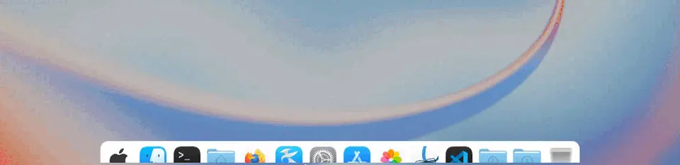
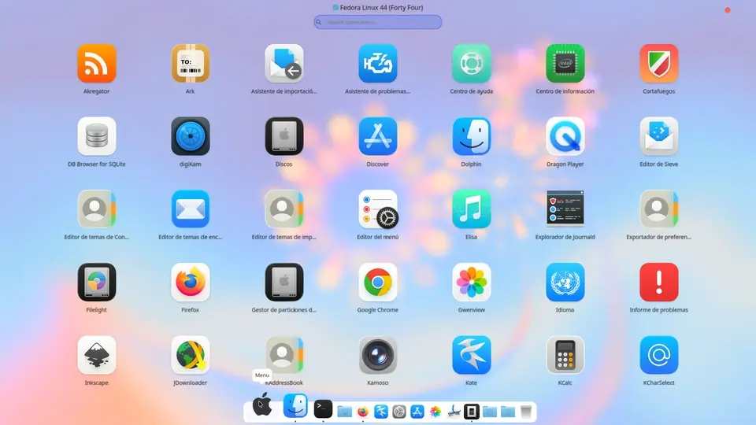
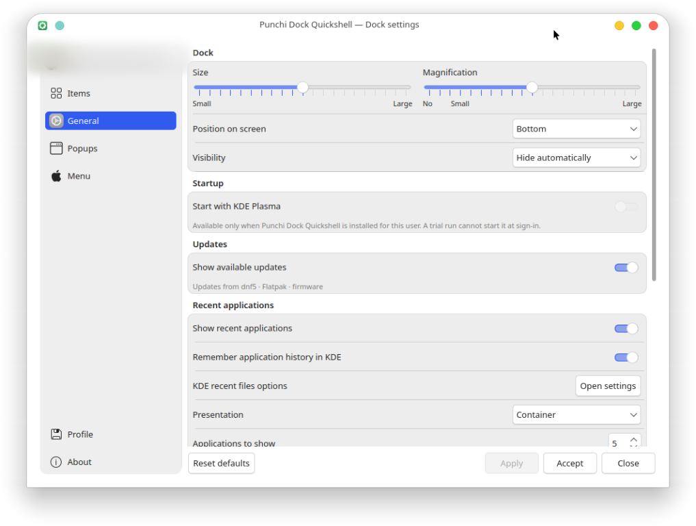
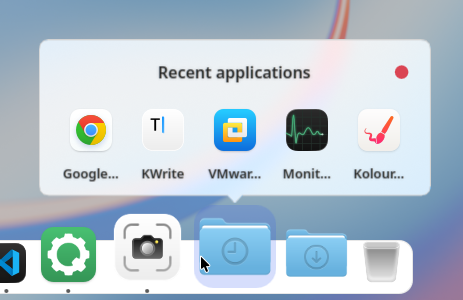
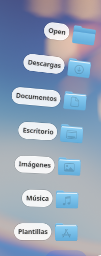
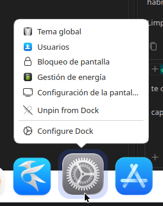

# Punchi Dock Quickshell

<p align="center"></p>

<p align="center"><strong>Un dock animado y configurable para KDE Plasma, construido con Quickshell e integración nativa de Qt/KDE.</strong></p>

[English](README.md) · [Español](README.es.md)

> [!WARNING]
> **En construcción — cambia con frecuencia.**
>
> Punchi Dock Quickshell está en desarrollo constante. Espera cambios de
> comportamiento, configuración, API nativas y documentación sin migración.
> Fedora 44 con KDE Plasma 6.7.5 y KWin 6.7.5 en Wayland, comprobado el
> 2026-10-20, es el entorno principal validado. Arch Linux y Debian 13.7 KDE
> han superado una compilación y un arranque inicial; la validación de uso
> prolongado y visual completa sigue pendiente. X11 queda fuera de alcance y no
> hay trabajo de soporte previsto. Otras distribuciones y compositores no están
> validados. Todavía no hay versión estable, paquete, compromiso de soporte ni
> garantía de compatibilidad.
>
> [Entornos validados](docs-public/getting-started/compatibility.md) ·
> [Limitaciones conocidas](docs-public/troubleshooting.md#known-limitations)

> [!NOTE]
> **Comprueba tu entorno antes de instalar.** Inicia el asistente
> (`./scripts-user/setup.sh`), ejecuta **Check runtime and build dependencies**
> y elige **Try it without installing (build, then run from this checkout)**.
> La prueba compila aquí y no instala nada, así puedes confirmar que el dock
> funciona en tu sistema antes de instalar una copia mientras el proyecto sigue
> en construcción.

<p align="center"></p>

<p align="center"><em>El dock ampliando los iconos alrededor del puntero en KDE
Plasma 6.8.2 con KWin 6.8.2 en Wayland. El conjunto de lanzadores es el del
mantenedor, no el predeterminado del primer arranque.</em></p>

Punchi Dock Quickshell combina ampliación animada, lanzadores de aplicaciones
configurables, un menú de aplicaciones a pantalla completa, acciones de contexto
y transporte multimedia de KDE, una ventana de ajustes y preferencias
persistentes. Convive con Plasma mediante scripts de inicio y restauración
reversibles.

Nació de los límites de
[Punchi Dock Remastered](https://github.com/PunchiSoft/punchi-dock-remastered),
el proyecto original y el applet de Plasma en el que se basa. Un applet vive
dentro de un panel de Plasma y hereda la superficie, el borde y el comportamiento
de ventana del anfitrión, así que el dock no puede tener su propia superficie
Wayland, elegir su comportamiento de borde en el compositor ni mantener una vida
e interacción independientes de Plasma. Este proyecto conserva el lenguaje visual,
la ampliación y la respuesta al clic de aquel dock, y reconstruye el lanzamiento,
la activación y el comportamiento del compositor como una aplicación Quickshell
independiente con adaptadores nativos de KDE.

**Se requiere KDE Plasma/KWin.** Punchi Dock Quickshell no es un dock de GNOME,
XFCE, Hyprland ni Wayland genérico. No funcionará en otro escritorio: el asistente
se niega a instalar fuera de KDE Plasma en Wayland, y arrancar una copia instalada
en otro entorno nombra la sesión encontrada y muestra un diálogo del sistema en
lugar de ejecutarse.

**Primera beta, sin publicar.** El árbol declara la versión
**0.2.0-beta.1** para el primer release público; todavía no hay tag ni GitHub
Release. El [registro de cambios](CHANGELOG.md) recoge el release preparado y
mantiene el trabajo nuevo pendiente bajo `Unreleased`.

[Atribución](NOTICE.md) · [Licencia](LICENSE) · [Registro de cambios](CHANGELOG.md) ·
[Seguridad](SECURITY.md) · [Contribuir](CONTRIBUTING.md) · [Soporte](SUPPORT.md)

## Qué hace

- **Aplicaciones y ventanas:** fija y reordena lanzadores descubiertos a través
  de KDE, lanza mediante KService y KIO con activación Wayland, trae al frente una
  ventana existente o minimiza la ventana activa elegible, y accede a acciones de escritorio,
  documentos recientes y Lugares de KDE desde el menú de contexto de un lanzador.
  [Leer más](docs-public/features/applications-and-windows.md)
- **Contenedores:** muestra cualquier carpeta local como Grid, List, Detail o Fan,
  con los contenedores integrados Home y Downloads, orden por contenedor,
  navegación por subcarpetas y un contenedor opcional de aplicaciones recientes
  basado en el historial de KDE.
  [Leer más](docs-public/features/containers.md)
- **PunchiMenu:** un menú de aplicaciones a pantalla completa por pantalla con
  búsqueda, orden alfabético/manual/por categorías, desplazamiento continuo, fondo
  con el tema y un dock opcional que permanece encima.
  [Leer más](docs-public/features/punchimenu.md)
- **Multimedia y estado:** transporte MPRIS para el reproductor correspondiente,
  un elemento Papelera nativo y una insignia en Discover que cuenta
  actualizaciones de PackageKit, fwupd y Flatpak.
  [Leer más](docs-public/features/media-and-updates.md)
- **Apariencia y movimiento:** ampliación continua, tooltips con el tema,
  respuesta de dos saltos al lanzar, colocación abajo/izquierda/derecha, un dock
  por pantalla y compatibilidad con movimiento reducido.
  [Leer más](docs-public/features/appearance-and-motion.md)
- **Integración con el escritorio:** ventana de ajustes con cambios pendientes,
  perfiles portables, un interruptor de autostart propiedad de Punchi y un efecto
  de minimizar de KWin cuyos valores originales se restauran.
  [Leer más](docs-public/features/desktop-integration.md)

## Capturas

<p align="center"></p>

<p align="center"><em>El menú a pantalla completa abriéndose desde el dock y
desplazándose por las aplicaciones instaladas. Seis segundos de una grabación más
larga; el conjunto de aplicaciones es del mantenedor.</em></p>

<p align="center">   </p>

<p align="center"><em>Las capturas muestran el dock, sus ajustes y sus popups en
Fedora 44 con Plasma 6.8.2, KWin 6.8.2 y Quickshell 0.2.1 en Wayland. El fondo de
pantalla, el cursor y el tema de escritorio son del mantenedor; el dock sigue el
tema activo de Plasma.</em></p>

[Más capturas y notas](assets/screenshots/README.md) · [Grabaciones de demostración](assets/demo/README.md).

## Documentación

La documentación publicada vive en [docs-public/](docs-public/README.md). Cada
página de funciones indica si un comportamiento está implementado, en desarrollo,
pendiente de validación o planificado.

| Si quieres… | Lee |
| --- | --- |
| Instalar, ejecutar, detener o desinstalar | [Primeros pasos](docs-public/getting-started/README.md) |
| Comprobar qué hace cada capacidad | [Funciones](docs-public/features/README.md) |
| Cambiar ajustes, modos o perfiles | [Configuración](docs-public/configuration/README.md) |
| Entender el código y el límite con KDE | [Arquitectura](docs-public/architecture/README.md) |
| Compilar, probar y revisar | [Desarrollo](docs-public/development.md) |
| Diagnosticar un arranque fallido o un aviso | [Solución de problemas](docs-public/troubleshooting.md) |
| Consultar el alcance actual | [Hoja de ruta](docs-public/roadmap.md) |
| Preparar una release | [Versionado](docs-public/versioning.md) |

## Inicio rápido

```bash
git clone https://github.com/PunchiSoft/punchi-dock-quickshell.git
cd punchi-dock-quickshell
./scripts-user/setup.sh
```

El asistente comprueba dependencias, compila los componentes nativos y ofrece
instalar el runtime para el usuario actual. Elige **Try it without installing**
para ejecutar desde el checkout sin instalar nada. Plasma sigue en ejecución
durante todo el proceso; el proyecto nunca reemplaza paneles ni servicios de
sesión.

Inicia el dock en primer plano con `./scripts-user/start.sh` y vuelve a una
interfaz KDE normal con `./scripts-user/restore-kde.sh`. Las instrucciones
completas, incluida la instalación con CMake y la desinstalación, están en
[Instalar y ejecutar](docs-public/getting-started/install.md).

## Compatibilidad

Fedora 44 con KDE Plasma 6.7.5, KWin 6.7.5 y Quickshell 0.2.1 en Wayland es el
único entorno con el grafo completo de validación automatizada. Arch Linux
(rolling) y Debian 13.7 KDE compilan y arrancan; el uso prolongado y la inspección
visual completa siguen pendientes. Quickshell usa API privadas de Qt, así que su
binario debe coincidir con la versión de Qt con la que se compiló.

Consulta [Compatibilidad](docs-public/getting-started/compatibility.md) para la
matriz validada, qué ejercitó cada fila y los riesgos de dependencias.

## Desarrollo

```bash
cmake --preset dev
cmake --build --preset dev
ctest --preset headless
```

`ctest --preset headless` ejecuta las etiquetas `unit` y `qml` sin sesión gráfica;
GitHub Actions ejecuta `scripts-dev/ci-headless.sh` en Fedora 44. El grafo
completo añade la etiqueta `session`, que necesita una sesión KDE Plasma/KWin
Wayland real. Lee [AGENTS.md](AGENTS.md) para las reglas del proyecto,
[CONTRIBUTING.md](CONTRIBUTING.md) para el flujo de ramas y evidencias, y
[Desarrollo](docs-public/development.md) para la ruta completa.

## Cómo está construido

`shell.qml` compone los módulos superiores habilitados; `modules/` posee cada
superficie, `components/` las primitivas compartidas, `services/` los datos y la
coordinación, y `adapters/kde/` el límite nativo con KDE. Una vista emite
intención, un servicio decide, un adaptador habla con el escritorio y el estado
reactivo vuelve a la vista. El mapa completo y la dirección de dependencias están
en [Arquitectura](docs-public/architecture/overview.md).

El inglés es el idioma fuente. En esta etapa solo se admiten cadenas de reserva en
inglés, y los ajustes actualizan las superficies existentes mediante estado
reactivo.

## Autoría y asistencia de desarrollo

Punchi Dock Quickshell lo desarrolla PunchiSoft. Se usan agentes de programación
con IA como apoyo para implementación, revisión y documentación. El mantenedor
sigue siendo responsable de todos los cambios, la validación y el contenido
publicado.

## Origen y atribución

La base de este proyecto es [Punchi Dock Remastered](https://github.com/PunchiSoft/punchi-dock-remastered),
el applet de Plasma cuyo dock, modelo de elementos, movimiento e interacción
reconstruye este port. También toma inspiración arquitectónica y visual de
[Caelestia Shell](https://github.com/caelestia-dots/shell), implementando la
integración de escritorio para KDE/KWin. Consulta [NOTICE.md](NOTICE.md) para el
código, los recursos y la atribución reutilizados.

## Hecho con cariño

Hecho con cariño, para la comunidad. Un port nativo del plasmoid [Punchi Dock
Remastered](https://github.com/PunchiSoft/punchi-dock-remastered), construido para
ir más allá de lo que un plasmoid puede hacer en KDE Plasma. Algunos dicen que los
docks pasaron de moda, como el punchi punchi; solo Windows los olvidó, y Linux
nunca lo hará.

**¡Linux para todos!**

## Licencia

GPL-3.0-or-later. Consulta [LICENSE](LICENSE) y [NOTICE.md](NOTICE.md).

Las habilidades de agente bajo [`.agents/skills/`](.agents/skills/README.md) pueden
reutilizarse y adaptarse. Conserva su campo `license`, el aviso de copyright y
cualquier entrada `metadata.source` que nombre el proyecto del que proceden; se
agradece citar este repositorio con el commit del que las tomaste. El catálogo de
habilidades indica las condiciones exactas.
