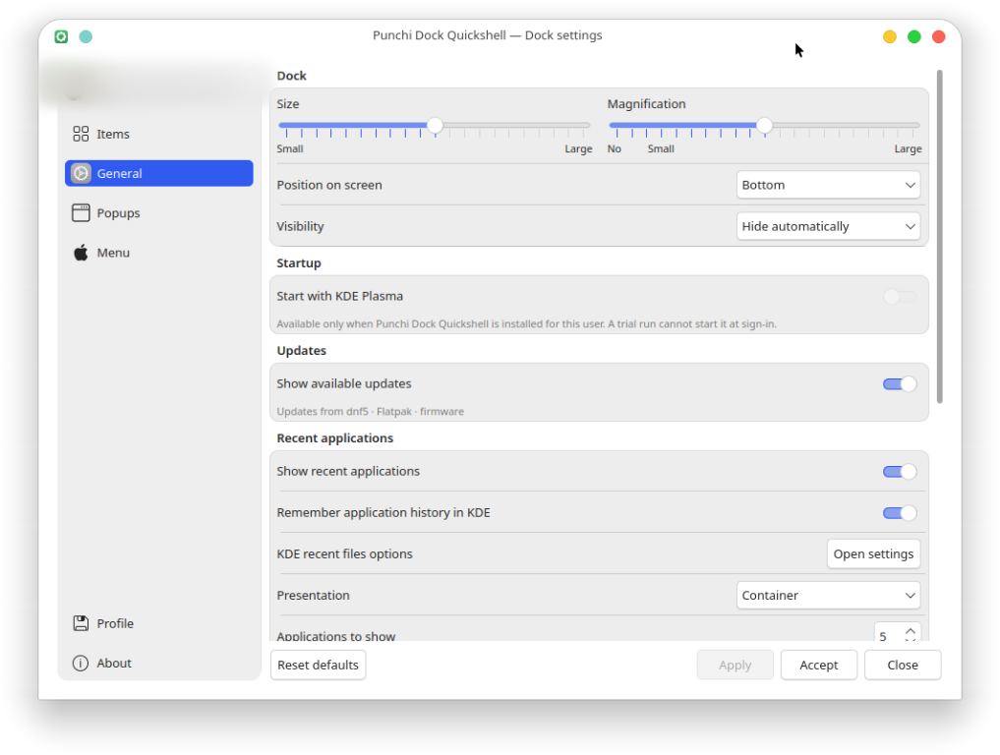
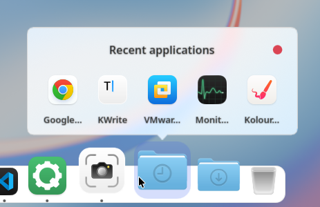
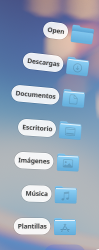
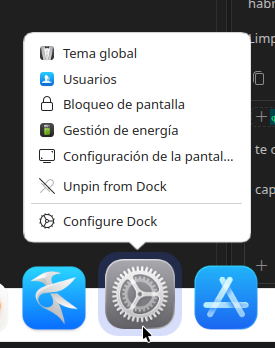

# Punchi Dock Quickshell

<p align="center"></p>

<p align="center"><strong>An animated, configurable dock for KDE Plasma, built with Quickshell and native Qt/KDE integration.</strong></p>

[English](README.md) · [Español](README.es.md)

> [!WARNING]
> **Under construction — actively changing.**
>
> Punchi Dock Quickshell is under constant development. Expect breaking changes
> to behavior, configuration, native APIs and documentation without migration.
> Fedora 44 with KDE Plasma 6.7.5 and KWin 6.7.5 on Wayland, checked 2026-10-20,
> is the primary validated environment. Arch Linux and Debian 13.7 KDE have a
> successful build and initial-start test; prolonged-use and full visual
> validation remain pending. X11 is out of scope and no support work is planned.
> Other distributions and compositors are unvalidated. There is no stable
> release, package, support commitment or compatibility guarantee yet.
>
> [Validated environments](docs-public/getting-started/compatibility.md) ·
> [Known limitations](docs-public/troubleshooting.md#known-limitations)

> [!NOTE]
> **Verify your environment before installing.** Start the guided setup
> (`./scripts-user/setup.sh`), run **Check runtime and build dependencies** and
> then choose **Try it without installing (build, then run from this checkout)**.
> The trial builds here and installs nothing, so you can confirm the dock works
> on your system before installing a copy while the project is still under
> construction.

<p align="center"></p>

<p align="center"><em>The dock magnifying the icons around the pointer on KDE Plasma
6.8.2 with KWin 6.8.2 on Wayland. The launcher set is the maintainer's, not the
first-run default.</em></p>

Punchi Dock Quickshell combines animated magnification, configurable application
launchers, a fullscreen application menu, KDE context actions and media
transport, a settings window and persistent preferences. It runs alongside
Plasma through reversible start and stop scripts.

It was born from the limits of
[Punchi Dock Remastered](https://github.com/PunchiSoft/punchi-dock-remastered),
the original project and the Plasma applet that is its base. An applet lives
inside a Plasma panel and inherits the host's surface, edge and window behavior,
so the dock cannot have its own Wayland surface, choose its edge behavior in the
compositor, or keep a lifespan and input model independent from Plasma. This
project keeps that dock's visual language, magnification and launch feedback,
and rebuilds its launching, activation and compositor behavior as a standalone
Quickshell application with native KDE adapters.

**KDE Plasma/KWin is required.** Punchi Dock Quickshell is not a GNOME, XFCE,
Hyprland or generic Wayland dock. It will not run on another desktop: the setup
assistant refuses to install outside KDE Plasma on Wayland, and starting an
installed copy elsewhere names the session it found and shows a system dialog
instead of running.

**Unreleased.** The tree declares version **0.1.47** for a future delivery; no
tag or release exists. The [changelog](CHANGELOG.md) keeps pending work under
`Unreleased` and each delivered change with its validation.

[Attribution](NOTICE.md) · [License](LICENSE) · [Changelog](CHANGELOG.md) ·
[Security](SECURITY.md) · [Contributing](CONTRIBUTING.md) · [Support](SUPPORT.md)

## What it does

- **Applications and windows:** pin and reorder launchers discovered through
  KDE, launch through KService and KIO with Wayland activation, bring an existing
  window forward or minimize an eligible active one, and reach KDE desktop actions,
  recent documents and Places from a launcher's context menu.
  [Read more](docs-public/features/applications-and-windows.md)
- **Containers:** show any local folder as Grid, List, Detail or Fan, with the
  built-in Home and Downloads containers, per-container sorting, subfolder
  browsing and an optional recent-applications container driven by KDE history.
  [Read more](docs-public/features/containers.md)
- **PunchiMenu:** a fullscreen application menu per screen with search,
  alphabetical/manual/category order, continuous scrolling, a theme-washed
  backdrop and an optional dock that stays over it.
  [Read more](docs-public/features/punchimenu.md)
- **Media and status:** MPRIS transport for the matching player, a native Trash
  item, and a Discover badge counting PackageKit, fwupd and Flatpak updates.
  [Read more](docs-public/features/media-and-updates.md)
- **Appearance and motion:** continuous magnification, themed tooltips,
  two-hop launch feedback, bottom/left/right placement, per-screen docks and
  reduced-motion support.
  [Read more](docs-public/features/appearance-and-motion.md)
- **Desktop integration:** a settings window with pending edits, portable
  profiles, a Punchi-owned autostart switch and a KWin minimize effect whose
  original values are restored.
  [Read more](docs-public/features/desktop-integration.md)

## Screenshots

<p align="center">   </p>

<p align="center"><em>The captures show the dock, its settings and its popups on
Fedora 44 with Plasma 6.8.2, KWin 6.8.2 and Quickshell 0.2.1 on Wayland. The
wallpaper, cursor and desktop theme are the maintainer's; the dock follows the
active Plasma theme.</em></p>

[More captures and capture notes](assets/screenshots/README.md).

## Documentation

Published documentation lives in [docs-public/](docs-public/README.md). Each
feature page states whether a behavior is implemented, in development, pending
validation or planned.

| If you want to… | Read |
| --- | --- |
| Install, run, stop or uninstall | [Getting started](docs-public/getting-started/README.md) |
| Check what each capability does | [Features](docs-public/features/README.md) |
| Change settings, modes or profiles | [Configuration](docs-public/configuration/README.md) |
| Understand the code and the KDE boundary | [Architecture](docs-public/architecture/README.md) |
| Build, test and review | [Development](docs-public/development.md) |
| Diagnose a failed start or a warning | [Troubleshooting](docs-public/troubleshooting.md) |
| Check current scope | [Roadmap](docs-public/roadmap.md) |
| Prepare a release | [Versioning](docs-public/versioning.md) |

## Quick start

```bash
git clone https://github.com/PunchiSoft/punchi-dock-quickshell.git
cd punchi-dock-quickshell
./scripts-user/setup.sh
```

The assistant checks dependencies, builds the native components and offers to
install the runtime for the current user. Choose **Try it without installing** to
run from the checkout without installing anything. Plasma keeps running
throughout; the project never replaces panels or session services.

Start the dock in the foreground with `./scripts-user/start.sh` and return to a
plain KDE interface with `./scripts-user/restore-kde.sh`. Full instructions,
including CMake installation and uninstall, are in
[Install and run](docs-public/getting-started/install.md).

## Compatibility

Fedora 44 with KDE Plasma 6.7.5, KWin 6.7.5 and Quickshell 0.2.1 on Wayland is
the only environment with the complete automated validation graph. Arch Linux
(rolling) and Debian 13.7 KDE build and start; prolonged use and full visual
inspection remain pending. Quickshell uses private Qt APIs, so its binary must
match the Qt version it was built for.

See [Compatibility](docs-public/getting-started/compatibility.md) for the
validated matrix, what each row exercised, and the dependency risks.

## Development

```bash
cmake --preset dev
cmake --build --preset dev
ctest --preset headless
```

`ctest --preset headless` runs the `unit` and `qml` labels without a graphical
session; GitHub Actions runs `scripts-dev/ci-headless.sh` on Fedora 44. The
complete graph adds the `session` label, which needs a live KDE Plasma/KWin
Wayland session. Read [AGENTS.md](AGENTS.md) for project rules,
[CONTRIBUTING.md](CONTRIBUTING.md) for the branch and evidence workflow, and
[Development](docs-public/development.md) for the full route.

## How it is built

`shell.qml` composes the enabled top-level modules; `modules/` owns each surface,
`components/` the shared primitives, `services/` the data and coordination, and
`adapters/kde/` the native KDE boundary. A view emits intent, a service decides,
an adapter talks to the desktop, and reactive state flows back. The complete map
and the dependency direction are in
[Architecture](docs-public/architecture/overview.md).

English is the source language. Only English fallback strings are supported at
this stage, and settings update existing surfaces through reactive state.

## Author and development assistance

Punchi Dock Quickshell is developed by PunchiSoft. AI coding agents are used as
development support for implementation, review and documentation. The maintainer
remains responsible for all changes, validation and published content.

## Origins and attribution

The base of this project is [Punchi Dock Remastered](https://github.com/PunchiSoft/punchi-dock-remastered),
the Plasma applet whose dock, item model, motion and interaction this port
rebuilds. It also takes architectural and visual inspiration from
[Caelestia Shell](https://github.com/caelestia-dots/shell), while implementing
desktop integration for KDE/KWin. See [NOTICE.md](NOTICE.md) for reused code,
assets and attribution.

## Made with love

Made with love, for the community. A native port of the [Punchi Dock
Remastered](https://github.com/PunchiSoft/punchi-dock-remastered) plasmoid,
built to go past what a plasmoid can do in KDE Plasma. Some say docks went out
of fashion, like the punchi punchi; only Windows forgot about them, and Linux
never will.

**Linux for everyone!**

## License

GPL-3.0-or-later. See [LICENSE](LICENSE) and [NOTICE.md](NOTICE.md).

The agent skills under [`.agents/skills/`](.agents/skills/README.md) may be reused
and adapted. Keep their `license` field, the copyright notice and any
`metadata.source` entry that names the project they came from, and citing this
repository with the commit you took them from is appreciated. The skill catalog
states the exact conditions.
