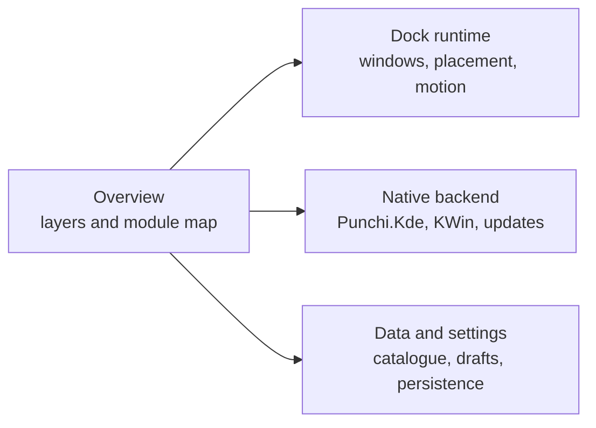

# Architecture

Explanation of how Punchi Dock Quickshell is built: which layer owns each
responsibility, how the pieces compose, and where the native KDE boundary sits.
These pages describe the tree as it is now; dated engineering evidence stays
outside the published documentation.

## Reading order

1. [Overview](overview.md): composition, layers, dependency direction and the
   module map.
2. [Dock runtime](dock-runtime.md): dock windows, placement, visibility,
   magnification, motion and popups.
3. [Native backend](native-backend.md): the `Punchi.Kde` module, KWin window
   access, updates, media and the owned KWin settings.
4. [Data and settings](data-and-settings.md): catalogues, dock models, settings
   drafts, persistence and profiles.

## Invariants

- `shell.qml` only composes enabled top-level modules.
- A view emits intent; a service decides; an adapter talks to the desktop;
  reactive state flows back to the view.
- Services never import visual components, and delegates never run commands or
  reach an adapter directly.
- KDE integration stays behind `adapters/kde/`; Quickshell only hosts the QML
  surfaces.
- `tests/architecture_test.py` enforces the dependency direction and the
  root-level composition rule.

The physical repository map is the **Repository tree** section of
[CONTRIBUTING.md](../../CONTRIBUTING.md), so it stays valid in every clone.
