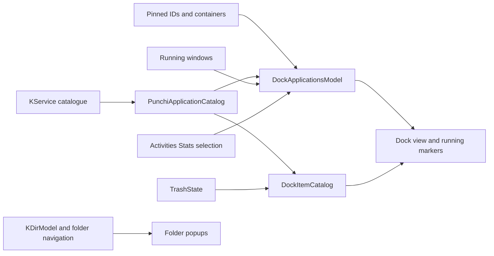
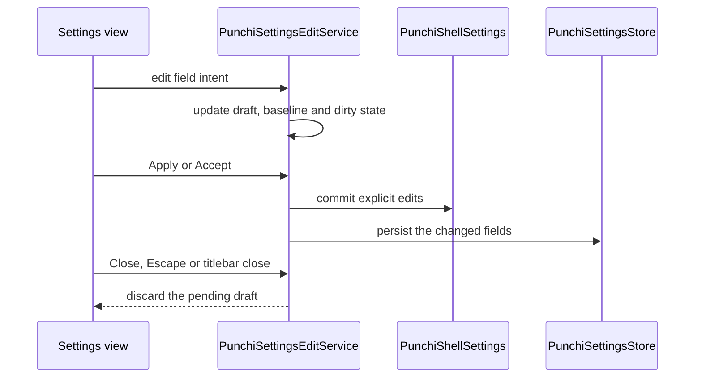

# Data and settings

How the dock gets its items, how a settings edit becomes pending state, and how
that state is persisted. Window access and desktop services are described in
[Native backend](native-backend.md).

## Data flow

## Application catalog

`PunchiApplicationCatalog` is a native Qt model built from `KService` desktop
metadata, refreshed by KSycoca database changes. The eight legacy preset IDs and
dock icons remain mapped, while new entries use `desktop:<storageId>`. The picker
uses native application names and icons plus a `QSortFilterProxyModel` for
installed-entry search, without a JavaScript copy of the application catalogue. It
filters `NoDisplay` and invalid desktop IDs; icon URLs cannot fetch remote content.
Search filter changes use row-filter notifications on supported Qt, with an older
Qt fallback. Identical catalogue reloads do not reset views.

## Dock models

`DockApplicationsModel` references pinned rows plus known running unpinned catalog
rows; transient entries never change persisted pins. Activation selects a row and
emits an ID. `PunchiApplicationActivationService` asks the separate window
activation domain to find and activate an existing native window inside the
backend, cycles matching groups or minimizes a single active window. A fresh
no-window result routes through `PunchiApplicationLaunchService` to
`PunchiDesktopApplicationAdapter`, which calls the native KDE launcher.

Special items use `DockItemCatalog`, a native concatenating model combining the
application catalog with separate item metadata. Trash has a structured item ID,
empty desktop ID and no application-picker presence. Existing pin ordering is
shared across item kinds.

## Containers

Folder containers use a native `KDirModel`/sort-proxy provider with reactive QML
roles. The built-in Home container resolves `QStandardPaths::HomeLocation` and
enables a proxy filter that keeps only the standard KDE/XDG user folders while the
listing is at that root. `PunchiFolderNavigationController` owns history and
file-opening intents, while the Grid/List/Detail content shares
`PunchiBalloonSurface`. An action-row proxy appends Grid's **Open in File Manager**
cell without copying directory rows. The existing KDE launch adapter resolves
preferred MIME applications and captures activation before popup dismissal.

Container presentation is shared. `components/PunchiEntryButton`,
`PunchiEntryLayout`, `PunchiEntryMarqueeLabel`, `PunchiFanView`, `PunchiFanRow`,
`PunchiFanGeometry`, `PunchiPopupHeader` and `PunchiPopupShadowLabel` render Grid,
List, Detail and Fan for two confirmed consumers: the folder container and the
recent-applications container. They take model rows, `PunchiPopupMetrics` and pointer/keyboard emphasis
as inputs and emit intents, so neither the popup host nor a delegate reaches a
service or an adapter.

`modules/recent` owns the recent container surface:
`PunchiRecentApplicationsPopup` anchors it to the dock item and confines the blur,
and `PunchiRecentApplicationsContent` draws the selection model the dock already
filters. The native `DockApplicationsModel` publishes either the resolved recent
rows or one `item:recent` row, never both, and that row exists only while the
selection has an application to show.

`PunchiRecentApplications` references Plasma Activities Stats through the native
adapter and selection proxy. It filters invalid, pinned and open applications and
bounds the visible count. The exclusion list follows `catalog.revision`, because a
preset row resolves its desktop id only after the asynchronous catalogue load;
without that dependency a pinned application reached the container. The selection
either appends resolved rows to `DockApplicationsModel` before special items
(`icons`) or feeds the container item and its popup (`container`, the first-run
value), never both. History is read from KDE; the project does not maintain a
second recent list.

The adapter keeps its `KActivities::Consumer` for its whole lifetime and builds the
Stats source only while the list is enabled, so `available` describes the KDE
service instead of the dock preference. That separation keeps the settings switch
usable after hiding the list and keeps recording dock launches while the list is
hidden. The history query is scoped to KDE's current activity; when the service
reports none, the adapter reads every activity instead of the empty current
activity, which would match nothing. That fallback affects only reading: KDE keeps
recording new launches for its current activity, so a session without one does not
grow the history. The adapter also reads `what-to-remember` from
`kactivitymanagerd-pluginsrc` and watches that file, because KDE records no
application history when the setting is "remember none"; the settings card uses
that state to disable the controls and explain the requirement. The adapter writes
only the two public states of that key when the user flips the remember-history
switch, and opens KDE's `kcm_recentFiles` module for the remaining options.

## Trash

`TrashState` owns KIO state and operations, `PunchiTrashService` owns the
confirmation decision, and Qt-only content and motion plus a window wrapper own
presentation. The existing application launcher handles directory-app selection
and activation for opening `trash:/`. The confirmation disables a destructive
action while the Trash is empty, unavailable or busy, and KDE supplies a fresh
listing after the job instead of an assumed empty result.

## Settings flow

`PunchiSettingsEditService` owns the window-wide `PunchiShellSettings` draft,
baseline and dirty state. The view emits Apply/Accept/Close intents;
`PunchiSettingsWindow` connects them to commit/cancel and window lifecycle. Only
Apply/Accept update the existing dock settings and `PunchiSettingsStore`. Untouched
fields follow external changes; explicit edits win field conflicts on commit. A
pending reset or added pin never reaches the dock or persistence on Close, titlebar
close or Escape. The window remains live after Apply, with a clean baseline;
opening an already visible window preserves its current draft. No service depends
on visual components.

`PunchiPinnedItemsEditService` owns selected item identity, bounded adjacent
reordering, and removal from the pending pin list. Removing a user folder also
removes its descriptor; it never deletes the directory or its contents. Built-in
Home and Downloads metadata remains available if their dock pin is removed. The
Items view exposes configure, native arrow and remove controls, tracks Qt model
structural signals to refresh its selected row, and preserves selection across
moves and removal. Up/down keyboard navigation selects list entries; action
activation changes the pending draft. Apply/Accept publish it through the existing
incremental pin projection, preserving unaffected dock delegates.

`PunchiApplicationPinService` owns application search and selection; only accepting
the modal adds the selected application to the settings draft. Containers carry
their selected Grid/List/Detail view, and Trash is offered only when not already
pinned. Discard, Escape and closing the settings window clear the picker state.
Selection never launches an application.

The application picker uses a larger results region and a left-aligned two-column
metadata grid, rather than `FormLayout`'s centered intrinsic columns.

## Defaults and identity

`PunchiDefaultProfile.js` owns the first-run launcher catalogue, pinned order,
containers, preference values and validation ranges. `PunchiShellSettings` starts
from that data and `reset()` restores a fresh copy, so a first install and an
explicit reset cannot drift.

A catalogue row either names one desktop entry or, with an empty `desktopId` plus
`defaultMimeTypes`, a role: `PunchiApplicationCatalog` asks
`KApplicationTrader::preferredService` for the ordered MIME types and publishes the
resolved `storageId`. The Browser item therefore opens whatever this KDE session
prefers, and every consumer — launching, running markers, window actions and media
control — keeps seeing one real desktop id. The resolved application's icon
replaces the role's own icon, and no picker duplicate is offered.

`PunchiDockItemIds.js` validates persistence IDs and unique pin lists, bounded to 32
entries within the 256 KiB profile limit, and validates folder-container entries
(stable slug, absolute or empty path, unique ids and a supported layout). Schema
version 7 retains the old preset/application and structured special-item IDs,
stores the layout on each container, adds per-container sorting, and adds the
recent-applications switch and count; version 13 adds the recent-applications
presentation and its container view, validated by `PunchiRecentPresentation.js`. A
compatibility `downloadsView` mirror preserves schema-3/4 profiles and existing
diagnostics.

The built-in Downloads container keeps its historical `item:downloads` id; the
built-in Home container and containers added later use `item:folder:<slug>`, which
the native catalogue exposes as one row each. An empty path is resolved by the
native provider: `home` uses `HomeLocation` and `downloads` uses
`DownloadLocation`. First-run defaults include Home between Konsole and the Browser
item with Fan/Name presentation and subfolder browsing off; a stored profile with
containers keeps its own list, so the default is not a migration. Unknown removed
applications stay in persisted pins and reappear when their desktop entry returns.
The pin projection inserts, moves, updates or removes only affected rows, preserving
other delegates. New pins use the existing KService/KIO launcher and native
context-menu pipeline. Raw commands, custom display metadata and other item kinds
are outside this first editor stage.

## Persistence

Preferences are stored per operating-system user in
`$XDG_CONFIG_HOME/punchi-dock-quickshell.json`, or
`~/.config/punchi-dock-quickshell.json` when `XDG_CONFIG_HOME` is unset. They are
not stored in the installed program files. At first start, an existing
`punchi-shell.json` is migrated to the new filename only when the new file does not
exist; the original file is kept as a backup. If both files exist, the new filename
takes precedence and neither is overwritten.

The current file format is version 16 and accepts versions 1 to 15 through
migration:

| Version | Adds |
| --- | --- |
| 7 | Recent-applications switch and visible count |
| 8 | Icon chosen for a pinned application |
| 9 | Folder entries a container keeps out of its popup |
| 10 | Popup size, height and icon size |
| 11 | Separate grid, list/detail and fan glyph sizes |
| 12 | Screen, virtual-desktop and activity selection plus the two placement switches |
| 13 | Recent-applications presentation and its container view |
| 14 | Fullscreen-menu presentation settings |
| 15 | Dock-over-menu switch |
| 16 | Category grouping, application order and the scroll bar that replaced the paging arrows |

Schemas 1 to 6 remain readable, with one-time Trash/Downloads migrations when
capacity permits. Missing fields in older profiles default to enabled, five
applications, the container presentation with the List view, the application icon,
an unfiltered folder listing, the reference popup proportions, the theme's glyph
sizes, every screen and every desktop/activity.

A trial run keeps its own profile in the instance runtime directory
(`$XDG_RUNTIME_DIR/punchi-dock-quickshell-$UID/trial-profile`, or the temporary
directory when `XDG_RUNTIME_DIR` is unavailable) and exports it as
`PUNCHI_PROFILE_DIR`. The dock's preferences and its autostart entry live there, so
a trial starts from the default items, never changes the profile an installed copy
owns, and cannot leave an entry that Plasma would load at sign-in.

## Portable profiles

`PunchiProfileDocument.js` validates the portable JSON exchange document and raw
saved profiles; `PunchiProfileExchangeService` previews the result on a separate
`PunchiShellSettings` and leaves the target untouched until confirmation. The
native `ProfileFile` bounds reads to 256 KiB, rejects FIFOs and devices, checks
UTF-8 and writes atomically with owner-only permissions while refusing
symbolic-link destinations.

A profile is data only: it contains no command, script, autostart entry or KDE
configuration. Exports use schema `punchi-dock-quickshell/profile` and format
version 1. Autostart remains an installation-level integration and is not part of
a profile.

## Owned autostart entry

`PunchiAutostartService` writes or removes a Punchi-owned XDG autostart entry. The
entry takes effect at the next Plasma sign-in, and an entry owned by another tool is
never overwritten or deleted. The switch is unavailable during a trial run, whose
profile Plasma never loads.
