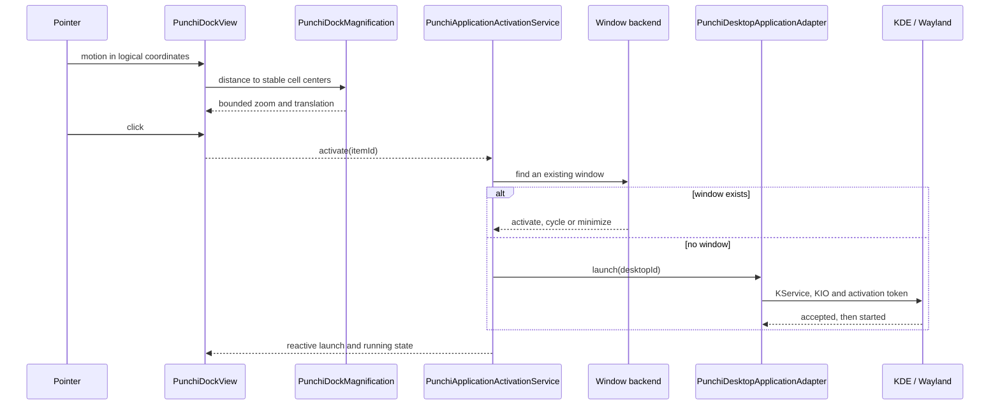
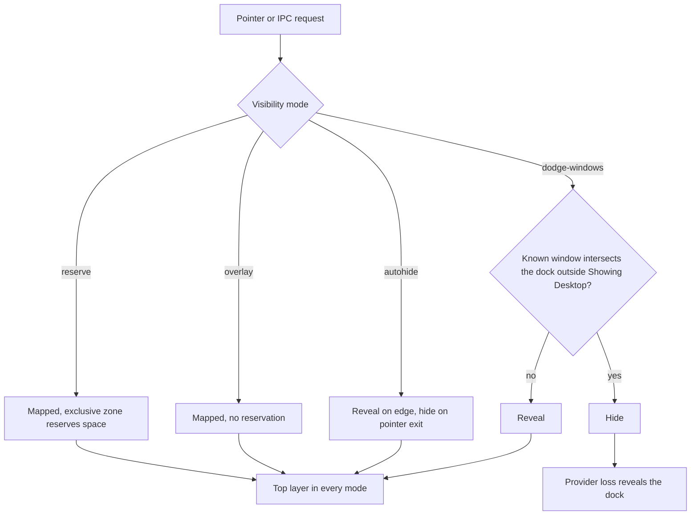

# Dock runtime

How the dock window is composed, placed, shown, magnified and dismissed. The
native helpers behind window access and edges are described in
[Native backend](native-backend.md).

## Window composition

```text
shell.qml
  └─ modules/dock/PunchiDock.qml        Quickshell window and wiring
       ├─ config/PunchiShellSettings    Reactive dimensions and motion preferences
       ├─ services/PunchiDockFixtureModel  Configured desktop IDs
       ├─ services/PunchiApplicationLaunchService  Validated intent routing
       │    └─ adapters/kde/PunchiDesktopApplicationAdapter → native/Punchi.Kde → KService/KIO
       └─ modules/dock/PunchiDockView   Qt/Kirigami view and intent signals
            ├─ modules/dock/PunchiDockMagnification  Spatial wave and entry/exit progress
            └─ components/PunchiDockTile  Unified icon/frame/hit transform
                 ├─ components/PunchiDockClickFeedback → PunchiTwoHopBounce
                 ├─ components/PunchiDockTooltip  Unscaled themed speech balloon
                 └─ components/PunchiAntialiasedSurface  Shared bounded MSAA profile
```

## Runtime sequence



This split lets Qt Quick Test exercise interaction without loading Quickshell's
statically registered runtime types. Real-session probes load the same Dock window
through Quickshell, then check rendering and lifecycle.

## Placement and screens

Dock placement is composed from three objects. `PunchiDockServices` owns the shared
catalog, window backend, update tracker, Trash state, item models, KWin minimize
controller and clipboard once. `PunchiScreenPolicy` decides which connected screens
may show a dock. `PunchiVirtualDesktopPolicy` decides whether the active virtual
desktop and KDE activity are allowed. `Variants` creates one `Dock` `PanelWindow`
per connected screen, so changing the selection or switching desktops never
recreates windows.

The policy keeps a disallowed window mapped but without exclusive zone, input mask
or edge trigger; unmapping every window would let the shell exit while a desktop
is excluded. `PunchiDockIpc` is the only `dock` handler and addresses a screen key.
When no selected screen is connected, `PunchiScreenPolicy` falls back to
`Native.ScreenInfo`, which exposes Qt's primary screen name.
`PunchiScreenSelection.js` holds the pure selection, identity and shared-edge
logic.

The panel supports bottom, left and right screen edges through
`PunchiShellSettings.dockEdge`. Orientation follows the selected edge. The bottom
allocation has one anchor; lateral allocations use top/bottom plus the selected
side so KWin supplies their usable main-axis extent, with compact content centered
inside the masked window. Normal modes respect other panels' exclusion zones; edge
modes retain the existing physical-edge policy.

## Visibility

`PunchiDockPanelPolicy` validates four native visibility modes and selects
base-space reservation; `PunchiDockVisibilityController` handles auto-hide and
window dodge. All modes use the Top layer. `PunchiPanelModes` normalizes the
retired desktop ID to `dodge-windows`. The default reserves no space; reserve mode
excludes the transparent top allocation. `PunchiDockIpc` changes the policy live
for every screen.



The dock accepts on-demand keyboard focus rather than exclusive focus. All Plasma
panels and services remain active; restoration stops only this configuration.
Future session replacement requires a separate explicit decision.

`AutoHideEdge` owns a separate, transparent Wayland edge sensor on the dock's named
output. KWin manages its native edge activation and themed glow. The sensor uses
an asynchronous private client connection, bounded shared-memory buffers, no
keyboard focus and no reserved space. Input is cleared immediately after
activation and while the dock is visible. Missing capabilities retain the dock's
local edge strip. This sensor does not own or animate the dock scene.

The dock keeps its stable client allocation to preserve menu and hover behavior.
`PunchiDockVisibilityController` animates a single reveal progress with
Plasma-like cubic entry/exit and KDE duration preferences. Completion settles
visibility without polling. `PunchiDockSlideGeometry` captures visual travel only
at settled endpoints, excludes unused top headroom and preserves the distance
during a reversal. Native edge handling and QML sliding have separate
responsibilities; there is no second compositor animation on the large dock
window.

`WindowVisibilityState` owns bounded geometry parsing and intersection queries
behind the shared process transport. `PunchiWindowOverlap` exposes its reactive
results to `PunchiDockVisibilityController`. `PunchiDockRestingGeometry` derives
the resting painted footprint from logical screen coordinates and KDE metrics,
independent of the large host allocation, zoom and slide. `dodge-windows` adds
hiding only for a known intersection outside Showing Desktop; provider loss
reveals the dock. Auto-hide keeps its original pointer-exit policy. Both surfaces
declare scope `dock`, which KWin uses for desktop-shell classification separately
from the Top/Bottom layers.

## Magnification

Pointer coordinates and logical cell centers remain stable during the wave. Only
entry/exit progress animates; pointer motion maps directly to the cosine
functions. The window reserves the maximum visual extent. The visible background
follows the main-axis bounds without changing its base thickness or feeding
layout back into the pointer calculation. Tooltips remain unscaled and follow the
rendered icon top or inward-facing side. Running markers remain below the icon in
every orientation.

The common cosine profile spans seven logical pitches, so three neighbours on each
side receive graded magnification. Its full amplitude follows the selected zoom;
there is no separately capped shoulder or narrow added peak. Horizontal
translation uses closed-form finite cosine sums: the displacement difference
between adjacent centres equals half their combined natural-cell growth,
preserving their original gap. Far translations saturate at the same profile's
maximum. The natural theme-derived cell, rather than additional slot padding,
defines this growth. No per-pointer loop, model rebuild or relayout is added.

`PunchiDockMetrics` defines the maximum icon ceiling as three times the normal
Kirigami base size. The existing 100–300% zoom preference selects the interval from
the chosen base size (100%, no enlargement) to that ceiling (300%). At the normal
base size it retains the original percentage/size relation; smaller bases can
reach the same maximum absolute theme size. Larger bases are never shrunk.
Texture resolution and static window reserves consume the effective scale,
including scales above 3 when the base is small. These proportions are calibrated
against the supplied macOS references, not Apple's exact formula or fixed pixels.

`PunchiDockMetrics` is also the shared geometry profile for settings, view and tile
defaults. It derives compact proportions from Kirigami icon sizes, spacing and
corner radius. The reference screenshot informs proportions without freezing KDE
theme units. Tooltip spacing and border metrics also use `Kirigami.Units`.

## Motion and launch feedback

`adapters/kde/PunchiMotionPreferences.qml` reads Kirigami durations and detects
disabled system animations through `shortDuration`. Settings expose a separate
explicit reduced-motion override. Reduced motion removes displacement and
animated entry, retaining at most an instant 8% active-item emphasis.

`PunchiTwoHopBounce` preserves the original two peaks and easing.
`PunchiDockClickFeedback` coalesces repeated feedback without suppressing
activation intents. Its offset adds to wave lift; the frame, hit target and
balloon remain tied to the control transform. Reserved window geometry includes
the maximum bounce amplitude. Disabled motion, hidden surfaces or disabled
controls reset feedback immediately.

## Popups and context menus

The dock context menu uses a nonmodal Qt Quick Controls `Popup.Item` in the same
`QQuickWindow` as the dock. A separate native Qt popup grabs Wayland input,
preventing interaction with other launchers until dismissal. `PunchiPopupAnchor`
captures rendered icon bounds; the wrapper normalizes the vertical coordinate
against the dock's base allocation and centers the popup above the icon, clamping
horizontally within the window.

`PunchiDockWindowGeometry` keeps the revealed client's transparent allocation
stable at the monitor height minus its bottom margin. Menu visibility and content
never resize the native window, avoiding transient Wayland
configure/buffer/input-coordinate changes during popup interaction. The visible
dock stays at its bottom baseline with unchanged surface height and exclusive
zone. Quickshell's input region combines the dock viewport and visible menu,
allowing surrounding transparent allocation to pass input to the desktop.
Auto-hide still collapses the native window after its slide finishes; its input
region follows the bottom activation strip while waiting for the resize.

`PunchiDockContextContent` supplies compact action rows and a separator. Inactive
rows have no separate background. `PunchiDockContextAction` sizes rows from the
system font, Kirigami icon metrics and padding. `PunchiBalloonSurface` supplies the
shared rounded body/pointer silhouette, theme colors and Kirigami metrics. Its
pointer uses client coordinates within the same window. Every popup row, listing
entry and popup control asks for the pointing hand while it can act and keeps the
arrow when it cannot: Qt 6 exposes no `Item.cursorShape`, so each control declares
a passive `HoverHandler` whose `cursorShape` follows that control's enablement.

Magnification remains active while visiting the menu and follows the pointer when
it returns to another launcher. Outside presses dismiss the nonmodal popup and
reach the clicked control in one interaction; Escape and focus restoration remain
available. Pending opens are cancelled when another launcher activates. Real KWin
input regions, placement and native activation remain separate session checks.

## Settings window visibility

Settings window visibility is composed into the dock's transient `configuring`
state. `PunchiDockConfigurationController` reveals the host and restores prior
explicit visibility on close. `PunchiDockPanelPolicy` requests Top during
configuration without changing the saved mode or reservation;
`PunchiDockVisibilityController` treats it as an interaction that holds auto-hide
revealed. Native panel hosting remains in Dock; shared controllers can be tested
with an offscreen window independently of KWin.

## References

Quickshell 0.2.1 installed type metadata and the versioned
[PanelWindow](https://quickshell.org/docs/v0.2.1/types/Quickshell/PanelWindow/) and
[keyboard-focus documentation](https://quickshell.org/docs/v0.2.1/types/Quickshell.Wayland/WlrKeyboardFocus/)
back these API choices. KDE capability claims still need actual compositor
evidence.
